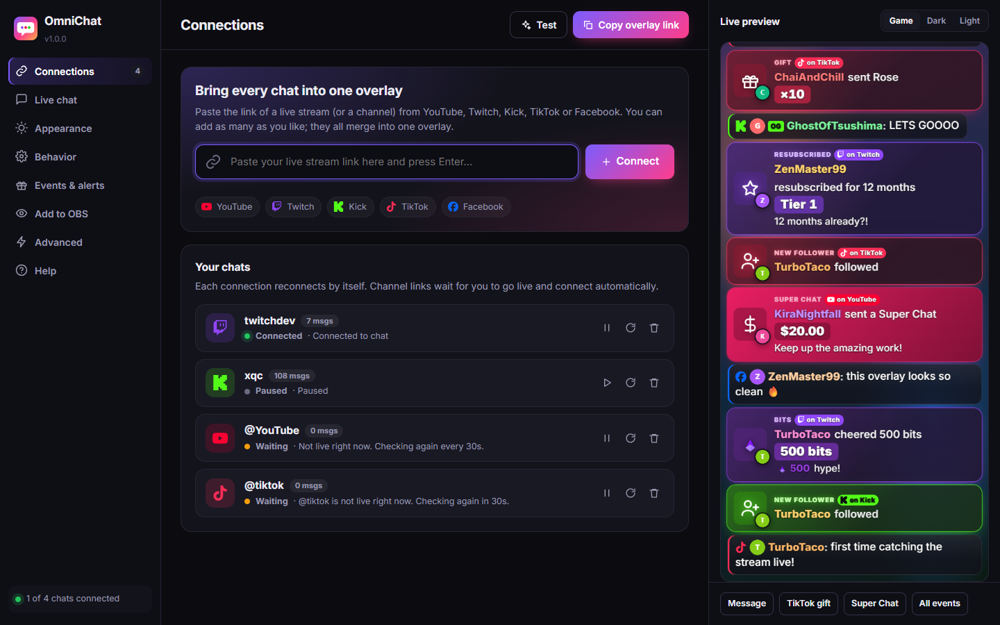
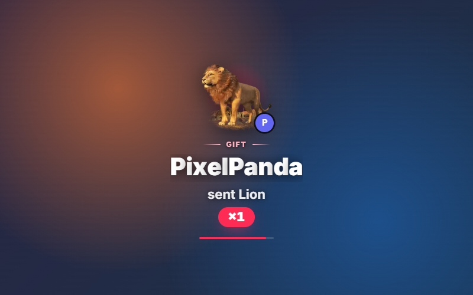
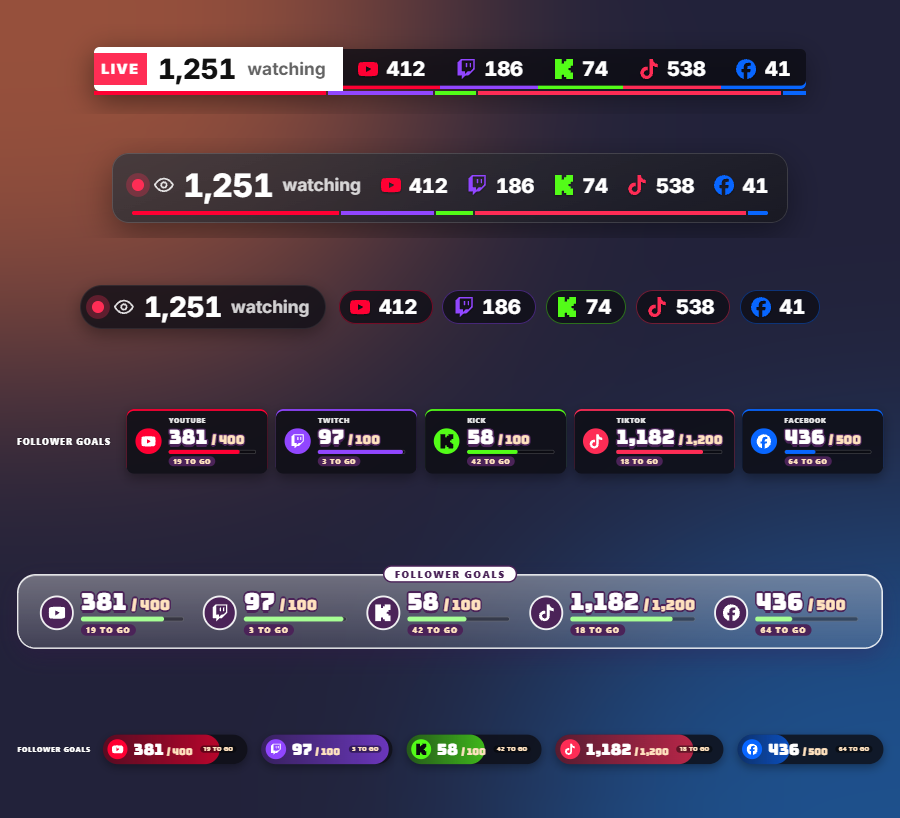
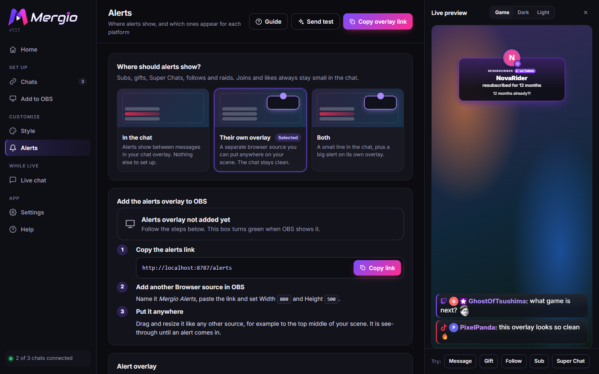
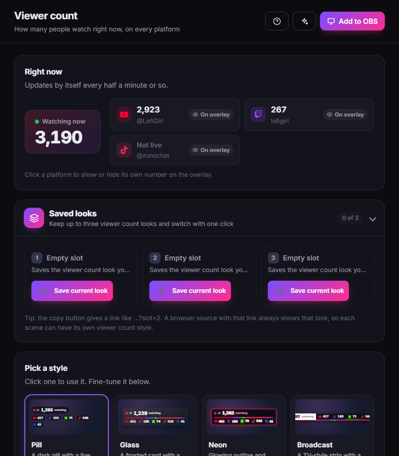
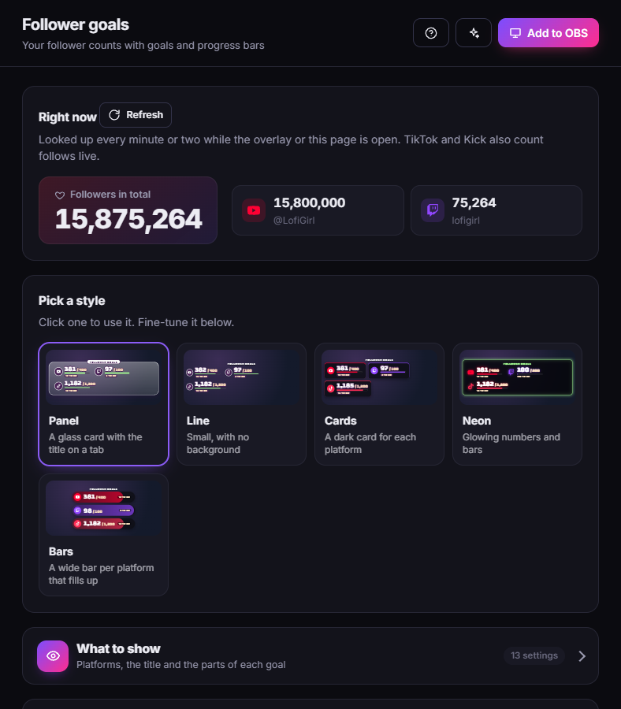

<div align="center">

<picture>
  <source media="(prefers-color-scheme: dark)" srcset="assets/brand/mergio-logo.svg">
  
</picture>

**Every live chat in one beautiful overlay.**
YouTube · Twitch · Kick · TikTok · Facebook, merged into one OBS browser source, with alerts, a viewer count and follower goals.

[](LICENSE)


[**Download**](https://github.com/ruchira-edirisinghe/mergio/releases/latest) · [Website](https://mergio-stream-overlay-gamma.vercel.app) · [Guide](#complete-guide) · [Help](#troubleshooting)



</div>

Multistreaming means your viewers chat in five places. Mergio reads all of them and shows them as one good-looking chat on your stream. **Type your username, press Enter, paste one link into OBS. Done.** No developer accounts, no API keys, no cloud: it runs on your own PC.

<table>
<tr>
<td align="center" width="33%"><br><b>Chat overlay</b><br><sub>Every chat in one list, with real profile pictures</sub></td>
<td align="center" width="33%"><br><b>Alerts overlay</b><br><sub>Gifts, subs, Super Chats and raids in fifteen styles, twelve of them game themes</sub></td>
<td align="center" width="33%"><br><b>Counters</b><br><sub>Live viewers and follower goals, even in one line</sub></td>
</tr>
</table>

## Features

- 🔗 **Connects by itself.** Add your channels once. Mergio connects when you go live and reconnects if the connection drops.
- 🎁 **The real thing, every time.** Real profile pictures, real TikTok and Kick gift pictures, combos that count up live, cheermotes and 7TV, BTTV and FFZ emotes.
- 🔔 **Alerts where you want them:** in the chat as calm lines, on their own overlay, or both. Fifteen styles: twelve game themes (Level up, Achievement, Loot drop, Arcade, Combo, Quest, Cyber HUD, Gacha pull, Item roulette, CRT broadcast, Transmission, Bounty poster) where bigger gifts get a rarer tier, plus Spotlight, Neon and Bubbly. Pick the colours, font, headline, what shows and one of seven sounds (a different one for each tier if you like), and add a pause between alerts. **Pause** or **Skip** alerts while you're live.
- 🗣️ **Read aloud:** a voice reads Super Chats, Bits and other messages from the alerts overlay, so OBS records it with the alert. It uses your computer's own voices, works offline and never reads a message with a blocked word.
- 👀 **Viewer count:** everyone watching on every platform, added up live, in five styles. Pick which platforms show, whether the total counts the hidden ones, and full or short numbers (1.2K).
- 🎯 **Follower goals:** each platform's followers with a goal and a progress bar that celebrates when you reach it, in five styles.
- ➖ **All in one line:** the counters can sit in a single row and shrink to fit any browser source.
- 🎨 **Your look:** six one-click chat styles, any Google Font, colours, boxes, layout and animation. Every setting has an icon and a plain-words tip, and the preview updates as you go.
- 🎁 **Matching packs:** one click gives the chat, alerts, viewer count and follower goals the same look. Ten packs: Level up, Arcade, Cyber, Gacha, Deep space, Late-night TV, Fantasy quest, Wild West, Bubbly and Clean.
- 💾 **Saved looks:** keep three looks for each overlay (chat, alerts, viewer count, follower goals), switch with one click, or give a scene its own look with `?slot=2`.
- 🌍 **Any language:** names and messages in Sinhala, Tamil, Hindi, Arabic, Hebrew, Japanese, Chinese, Korean, Thai and more show correctly, right-to-left included.
- 💬 **Live chat page:** read every chat in one list and filter it by platform or by chat and alerts. **Pin** a message to the top of your overlay, **hide** single messages, or pick several and keep only those when you clear the chat.
- 🧩 **OBS docks:** three small panels inside OBS (the full chat, the gifts and alerts you received with your top supporters, and your live viewer count with the peak and the last hour), added with one button.
- 👋 **Joins and likes your way:** switch "joined the chat" and TikTok likes on or off for the chat overlay.
- 🛡️ **Clean chat:** moderation sync, filters for bots, `!commands` and words, and a minimum TikTok gift value.
- ⚡ **Instant and lightweight:** changes reach OBS straight away, it uses about 50 to 80 MB of memory, and it works on any screen size, from a phone to a big monitor.
- 🚀 **Easy to keep up to date:** a guided installer that explains every choice, and one-click updates with release notes.
- 🔒 **Private:** everything runs on `localhost`. No telemetry, no accounts.

| Platform | Chat | Alerts | Viewers | Followers | Needs a key? |
|---|:---:|---|:---:|:---:|---|
| **YouTube** | ✅ | Super Chats, Super Stickers, members, milestones, gifted memberships | ✅ | ✅ | No |
| **Twitch** | ✅ | Bits, subs, gift subs, raids, Hype Chats, announcements, Power-ups, watch streaks | ✅ | ✅ | No |
| **Kick** | ✅ | Follows, subs, gifted subs, KICKs gifts, hosts, rewards | ✅ | ✅ | No |
| **TikTok** | ✅ | Gifts, follows, subscriptions, joins, likes, shares | ✅ | ✅ | No (an optional free key raises limits) |
| **Facebook** | ✅ | Comments | ✅ | ✅ | A free Page token ([how](docs/facebook.md)) |

<sub>* Only Facebook needs a key. Twitch only shares new followers with logged-in apps, so Twitch follow alerts aren't available.</sub>

## Complete guide

About five minutes from download to your first stream.

### Step 1 · Download and install

Get the file for your computer from the [**latest release**](https://github.com/ruchira-edirisinghe/mergio/releases/latest):

| Your computer | File | |
|---|---|---|
| **Windows 10 / 11** | `Mergio-Setup-windows-x64.exe` | Installer (recommended) |
| | `Mergio-windows-x64-portable.zip` | No install: unzip and run |
| **Mac** (Apple silicon) | `Mergio-macos-arm64.dmg` | Drag to Applications |
| **Ubuntu, Debian, Mint…** | `Mergio-linux-x64.deb` | `sudo apt install ./Mergio-linux-x64.deb` |
| **Any other Linux** | `Mergio-linux-x64.tar.gz` | Unpack and run `./install.sh` |

The Windows installer explains each step: what it installs, where and why. If Windows says *"Windows protected your PC"*, click **More info → Run anyway** (Mergio is free, so it isn't code-signed).

<details><summary>macOS and Linux notes</summary>

- **macOS:** the first time, macOS says it can't check the app. Open **System Settings → Privacy & Security** and click **Open Anyway**. You only do this once. (Or run `xattr -dr com.apple.quarantine /Applications/Mergio.app`.)
- **Linux:** open Mergio from your app menu or run `mergio`. Kick uses `curl`, which most systems already have.
</details>

Mergio opens its **control panel** in your browser at `http://localhost:8787`. A short tour shows the next steps, and the **Guide** button brings it back any time.

### Step 2 · Add your chats

Open **Chats**, pick a platform, type your username and press **Enter**. Do this for every platform you stream to. Chats that aren't live yet say *Waiting for you to go live* and connect by themselves.

<div align="center"></div>

<details><summary>Which links work?</summary>

| Platform | Type or paste |
|---|---|
| YouTube | `@yourname` (finds your live stream), or a `youtube.com/watch?v=…`, `youtu.be/…` or `youtube.com/live/…` link |
| Twitch | `yourname` or `twitch.tv/yourname` |
| Kick | `yourname` or `kick.com/yourname` |
| TikTok | `yourname` or `tiktok.com/@yourname` |
| Facebook | `facebook.com/yourpage` (finds your live video; needs a [Page token](docs/facebook.md)) |
</details>

### Step 3 · Pick a look

Open **Chat style** and click a style. Open a section below it to fine-tune: each setting has an icon, and the settings that belong to another one sit indented under it. Hover **ⓘ** for a tip, or use the search box to find any setting.

<div align="center"></div>

### Step 4 · Choose your alerts

Open **Alerts** and choose where alerts show: **in the chat**, on **their own overlay**, or **both**. Pick one of the fifteen styles (each tile plays a preview). The game themes give bigger gifts a rarer tier (Common, Rare, Epic, Legendary), and you can change their colours, font, headline, sound and what shows. Then switch off anything you don't want on stream, and press **Try** to see any alert.

Under **Sound** you can give each tier its own sound (press **Hear it** to listen). Under **Timing and size**, **Space between alerts** adds a pause when several come in at once. Switch on **Read messages aloud** to have a voice read them: pick which alerts (every alert, or only Rare and bigger, and so on), the voice and the speed. On Windows and macOS the voices are already there. On Linux, install `espeak-ng`.

<div align="center"></div>

### Step 5 · Add counters (optional)

**Viewer count** shows how many people watch on each platform and in total. **Follower goals** shows each platform's followers with a goal: with a step of 100, 436 followers aims for 500, and the next goal appears by itself. You can also set your own goal for each platform. Choose **All in one line** under *Layout* to keep everything in a single row. On **Viewer count**, click a platform under *Right now* to show or hide its own number.

To make everything match in one go, open **Style → Matching packs** and pick a pack. It sets the chat style, alert style, viewer count and follower goals together, and keeps your chats, switches, goals, sizes and positions. **Undo** puts back what you had.

Every overlay page has **Saved looks** at the bottom: three slots to save the look you have, switch back to it later, or copy a `?slot=N` link so one scene always uses that look.

<div align="center">
 
</div>

### Step 6 · Add it to OBS

Open **Add to OBS** (the button at the top of every page takes you there). It lists each overlay with its link, its size and whether OBS shows it yet.

1. Click **Copy link** on the overlay you want.
2. In OBS, click **+** under *Sources*, choose **Browser** and click **OK**.
3. Paste the link into **URL** and use the size the card shows. Click **OK**.

| Overlay | Link | Size |
|---|---|---|
| Chat | `http://localhost:8787/overlay` | 500 × 800 |
| Alerts | `http://localhost:8787/alerts` | 800 × 500 |
| Viewer count | `http://localhost:8787/viewers` | 800 × 200 |
| Follower goals | `http://localhost:8787/followers` | 1000 × 300 |

The card turns green when OBS shows it. You never copy the link again: every change reaches OBS straight away. It works the same in Streamlabs, Meld, vMix, XSplit and TikTok LIVE Studio.

<div align="center"></div>

### Step 7 · Read every chat while you're live

Open **Live chat** to read every chat in one list. Click a platform to see only that one, or switch between **Chat** and **Alerts**.

- **Pin** a message (the pin on each message) to keep it at the top of your chat overlay until you unpin it.
- **Hide** one message (the eye) or press **Select**, pick messages (Shift+click picks a range) and choose **Hide from overlay** or **Keep only these**.
- **Pause** holds new alerts until you resume, so none are lost. **Skip** ends the one on screen.

To keep all of this inside OBS, open **Add to OBS → OBS docks** and press **Install the docks in OBS**. If OBS is open, close it when Mergio asks: Mergio adds the docks the moment OBS closes (OBS saves its own settings when it closes, so they can't be added while it runs). You get three docks: **Mergio Chat** (`/dock/chat`), **Mergio Gifts** (`/dock/gifts`, with a ▶ to replay any alert) and **Mergio Viewers** (`/dock/viewers`). Mergio keeps any docks you added yourself. To add them by hand, use **Docks → Custom Browser Docks…** in OBS with those links.

<div align="center"></div>

🎉 **You're all set.** Turn on **Settings → Start Mergio with Windows** so it's always ready.

## Good to know

<details><summary><b>Use Mergio in its own window</b></summary>

In Chrome, Edge or Brave, click **Install app** at the top of the control panel. Mergio then opens in its own window with its own taskbar icon.
</details>

<details><summary><b>A different look for one scene</b></summary>

Add settings to an overlay link to change them for that browser source only:

```
http://localhost:8787/overlay?theme=neon&fontSize=28&align=right
http://localhost:8787/alerts?style=levelup&size=1.3&position=top
http://localhost:8787/viewers?style=broadcast&layout=line
http://localhost:8787/followers?style=bars&layout=column
http://localhost:8787/overlay?slot=2
```

`?slot=1`, `2` or `3` uses one of your saved looks for that browser source.
</details>

<details><summary><b>Update or uninstall</b></summary>

Mergio checks for a new version each time it opens and shows what's new. On Windows, **Download and install** updates it in one click. On other systems, **Get the new version** opens the download page. Your chats and settings are always kept.

To uninstall on Windows, use *Settings → Apps → Mergio → Uninstall* (the portable version is just a folder). On macOS, drag Mergio to the Bin. On Linux, run `sudo apt remove mergio` or `./uninstall.sh`. To keep your look, use **Settings → Back up your style** first.
</details>

<details><summary><b>Platform notes</b></summary>

- **YouTube** uses the same public feed as YouTube's pop-out chat, so there's no key and no quota. A free YouTube Data API key (Settings → Accounts & keys) makes follower lookups steadier.
- **Twitch** connects anonymously, like a logged-out viewer.
- **Kick** reads the public chat as a guest.
- **TikTok** uses the open-source [TikTok-Live-Connector](https://github.com/zerodytrash/TikTok-Live-Connector) and connects while you're LIVE. If you see a rate-limit message, add a free [Euler Stream](https://www.eulerstream.com) key in Settings → Accounts & keys.
- **Facebook** needs a free Page token. [Make one in 5 minutes](docs/facebook.md), or click **Show me how** in Settings → Accounts & keys.
</details>

## Troubleshooting

<details><summary><b>The overlay is empty in OBS</b></summary>

Check that `http://localhost:8787` opens the control panel and that the OBS link matches the one on **Add to OBS**. Press **Send test**: if test messages show, chat will appear when people type. You can also right-click the source and choose **Refresh**.
</details>

<details><summary><b>A chat says "Waiting"</b></summary>

That platform isn't live yet. Mergio keeps checking and connects by itself.
</details>

<details><summary><b>TikTok or Facebook shows an error</b></summary>

TikTok: make sure you're LIVE and the username is right. Facebook: the token has run out; make a new one with **Show me how** (steps 3 to 7 of the [Facebook guide](docs/facebook.md)).
</details>

<details><summary><b>Nothing happens when I open Mergio, or port 8787 is taken</b></summary>

Mergio has no window of its own: it opens the control panel in your browser. Open `http://localhost:8787` yourself. If another app uses the port, change it in **Settings → Mergio app** and update the links in OBS.
</details>

<details><summary><b>Where are the logs?</b></summary>

`mergio.log` sits next to your settings. **Settings → Back up your style** shows the folder and has an **Open folder** button.
</details>

Still stuck? [Open an issue](https://github.com/ruchira-edirisinghe/mergio/issues/new/choose).

## Privacy & security

- Mergio listens on **127.0.0.1 only**, so nothing on your network can reach it, and websites in your browser can't use it.
- No telemetry and no analytics. The only request it makes on its own is the update check to GitHub. Follower goals look counts up only while they're on screen (TikTok and Facebook in a hidden browser that can only open their pages).
- Keys and tokens stay in your local settings file. They never reach the overlays and are kept out of the log.
- Updates only install when their checksum matches the one GitHub publishes. Mergio only **reads** chat: it never posts or logs in as you.

Found a security problem? See [SECURITY.md](SECURITY.md).

## Build it yourself

Needs [Node.js](https://nodejs.org) 20 or newer.

```bash
git clone https://github.com/ruchira-edirisinghe/mergio.git
cd mergio
npm install
npm start            # or: npm run dev (restarts when you edit files)
npm run build        # one executable in dist/
npm run package      # installers for this system in dist/release
```

How it works, the message format, the local API and how to add a platform are in [docs/DEVELOPERS.md](docs/DEVELOPERS.md). Bug reports, ideas and pull requests are welcome; please open an issue first for bigger changes.

## Credits

Mergio was created by **[Ruchira Edirisinghe](https://ruchiraedirisinghe.vercel.app)**. Contributions from other people were added later.

Thanks to [TikTok-Live-Connector](https://github.com/zerodytrash/TikTok-Live-Connector) and [Euler Stream](https://www.eulerstream.com), [ws](https://github.com/websockets/ws), [Simple Icons](https://simpleicons.org), [7TV](https://7tv.app), [BetterTTV](https://betterttv.com), [FrankerFaceZ](https://www.frankerfacez.com), [pronouns.alejo.io](https://pronouns.alejo.io) and [DecAPI](https://decapi.me). Mergio isn't affiliated with YouTube, Twitch, Kick, TikTok or Meta.

## License

[MIT License, with credit to the creator](LICENSE) © Ruchira Edirisinghe. You can use, modify and share Mergio, including commercially. The one extra condition: any copy, fork or project based on Mergio must clearly credit **Ruchira Edirisinghe** as the creator of Mergio, in its README and in its about or credits screen if it has one.
