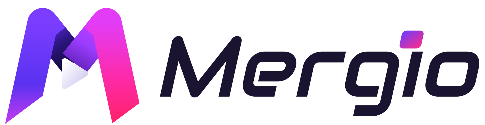

<div align="center">

<picture>
  <source media="(prefers-color-scheme: dark)" srcset="assets/brand/mergio-logo.svg">
  
</picture>

**Every live chat in one beautiful overlay.**
YouTube · Twitch · Kick · TikTok · Facebook, merged into a single OBS browser source.

[](LICENSE)


</div>

---

Multistreaming means your viewers chat in five different places. Mergio reads all of them at once and shows them as one good-looking chat on your stream, with real-time alerts for subs, gifts, Super Chats, raids, Bits, TikTok gifts and more.

**Paste a link. Press Enter. Done.** There are no developer accounts or API keys to set up, and no cloud service between you and your chat. It all runs on your own PC.

## Contents

- [Features](#features)
- [Supported platforms](#supported-platforms)
- [Quick start (2 minutes)](#quick-start-2-minutes)
- [Add the overlay to OBS](#add-the-overlay-to-obs)
- [Customize the look](#customize-the-look)
- [Platform notes](#platform-notes) (YouTube, Twitch, Kick, TikTok, Facebook)
- [Run from source](#run-from-source) / [Build the app yourself](#build-the-app-yourself)
- [How it works](#how-it-works)
- [Privacy & security](#privacy--security)
- [Troubleshooting](#troubleshooting)
- [For developers](#for-developers)
- [Contributing](#contributing) · [Credits](#credits) · [License](#license)

## Features

- 🔗 **Paste-and-go connections.** Paste any stream or channel link. Mergio detects the platform, connects, and reconnects by itself if the connection drops.
- ⏳ **Auto-connect when you go live.** Add your YouTube or TikTok channel once. Mergio waits and connects the moment your stream starts.
- 🎉 **Subscriber & follower alerts** as big animated cards that name the platform (e.g. **NEW FOLLOWER · on TikTok**, **NEW SUBSCRIBER · on Kick**), with a little celebration burst.
- 🎁 **Alerts that look the part:**
  - TikTok gifts with the real gift artwork, and combos that count up live (×1 → ×10 → ×50)
  - TikTok joins, likes, follows and shares
  - Twitch Bits with animated cheermotes, subs, gift subs, raids, Hype Chats, announcements, Power-ups and watch streaks
  - YouTube Super Chats in their real tier colors, Super Stickers, new members, milestones and gifted memberships
  - Kick subs, gifted subs, Kicks gifts, hosts and reward redemptions
- 😀 **Emotes everywhere:** Twitch, 7TV, BetterTTV, FrankerFaceZ, YouTube custom emoji, Kick emotes, and cheermotes.
- 🎨 **Fully customizable:** 6 one-click styles (Glass, Neon, Minimal, Soft light, Retro pixel, Bold cards), any Google Font, colors, bubbles, opacity, roundness, animations, alignment, direction, emote size and more. A live preview updates as you change things.
- ⚡ **Instant updates.** Style changes reach OBS immediately; you never re-copy the overlay link.
- 🧹 **Moderation sync:** messages deleted or users banned on Twitch, YouTube or Kick vanish from the overlay too.
- 🛡️ **Filters:** hide `!commands`, bots, blocked words or a whole event type; set a minimum TikTok gift value; choose who may post images.
- 💬 **One feed for you:** a "Live chat" tab to read every chat in one list. You can dock it inside OBS.
- 🪶 **Lightweight:** one small background app (about 50–80 MB of memory, no window of its own). The overlay only uses GPU-friendly animations.
- 🔒 **Private:** everything runs on `localhost`. No telemetry, no accounts, no cloud.

<div align="center"></div>

## Supported platforms

| Platform | Chat | Events | Login / key needed? |
|---|---|---|---|
| **YouTube** | ✅ | Super Chats, Super Stickers, members, milestones, gifted memberships | No |
| **Twitch** | ✅ | Bits, subs, gift subs, raids, Hype Chats, announcements, Power-ups, watch streaks, joins | No |
| **Kick** | ✅ | Subs, gifted subs, Kicks gifts, hosts, reward redemptions, follows | No |
| **TikTok** | ✅ | Gifts (with images), joins, likes, follows, shares, subscriptions | No (optional free key raises limits) |
| **Facebook** | ✅ | Comments | **Yes**, a free Page access token ([how](#facebook)) |

\* Facebook does not allow reading live comments without a token. Twitch follows require a logged-in app, and Kick/YouTube don't publish viewer joins, so those few events aren't available.

## Quick start (2 minutes)

1. **Download** the latest `Mergio` for your system from the [**Releases page**](https://github.com/ruchira-edirisinghe/mergio/releases/latest):
   - Windows: `Mergio-windows-x64.zip`. Unzip it anywhere (for example `D:\Software\Mergio`) and double-click **Mergio.exe**.
   - macOS / Linux: download the matching file, then run `chmod +x mergio && ./mergio`.
2. The **control panel** opens in your browser at `http://localhost:8787`.
3. **Paste the link** of your live stream (or channel) into the big box and press **Enter**. Repeat for each platform.
4. Go to **Add to OBS**, click **Copy**, and add it to OBS as a Browser Source ([details below](#add-the-overlay-to-obs)).
5. Click **Test** to see sample messages and alerts, then pick a style under **Appearance**.

> **Windows SmartScreen** may say "Windows protected your PC" because the app isn't code-signed (signing certificates are expensive for free projects). Click **More info → Run anyway**. You can also [build it yourself](#build-the-app-yourself) from this source code.

The app has no window. To close it, use **Advanced → Quit Mergio**. Starting it again while it's already running just opens the control panel.

**What links work?**

| Platform | Examples |
|---|---|
| YouTube | `youtube.com/watch?v=VIDEO_ID`, `youtu.be/VIDEO_ID`, `youtube.com/live/VIDEO_ID`, or your channel `youtube.com/@yourname` (auto-finds your live) |
| Twitch | `twitch.tv/yourname` |
| Kick | `kick.com/yourname` |
| TikTok | `tiktok.com/@yourname` or `tiktok.com/@yourname/live` |
| Facebook | `facebook.com/yourpage/videos/1234567890` or `facebook.com/watch/?v=1234567890` |
| Shortcuts | `twitch:name`, `kick:name`, `tiktok:name`, `yt:@name` |

## Add the overlay to OBS

1. In OBS click **+** under *Sources* → **Browser**.
2. URL: `http://localhost:8787/overlay` (copy it from the **Add to OBS** tab).
3. Width `500`, Height `800` (any size works; the chat fills the box).
4. Click **OK**. Done. Works the same in Streamlabs Desktop, Meld, vMix, XSplit and TikTok LIVE Studio (as a browser/web source).

**Control panel inside OBS:** *Docks → Custom Browser Docks…*, name `Mergio`, URL `http://localhost:8787/dashboard`. Now you can read all chats and change settings without leaving OBS.

## Customize the look

Everything lives in the control panel, with a live preview on the right:

| Tab | What you can change |
|---|---|
| **Appearance** | Style presets, alert labels with platform name, follower alerts as cards or pills, platform icons, avatars, badges, usernames, pronouns, timestamps (12/24h), font, size, weight, spacing, text/username colors, text shadow, bubbles (color, opacity, roundness, platform strip), background, animation, alignment, max messages, emote size, big emotes, event style |
| **Behavior** | Hide-after timer, newest at top/bottom, one-line or two-line layout, grouping, join pill time, `!command` filter, image permissions, ignored bots, blocked words, mention highlighting, UwU mode |
| **Events & alerts** | Every message and event type per platform, Twitch shared chat, minimum TikTok gift value |
| **Advanced** | Facebook token, optional TikTok key, port, export/import your style, reset |

**Different looks per scene:** add any Appearance/Behavior option to the overlay link to override it for that browser source only:

```
http://localhost:8787/overlay?fontSize=28&theme=neon&align=right&maxMessages=12
```

Useful options: `theme` (glass, neon, minimal, soft, retro), `fontSize`, `font`, `align` (left/right), `scrollDirection` (normal/reversed), `hideAfter` (seconds), `maxMessages`, `showAvatar`, `showPlatform`, `useChatBubbles`, `inlineChat`, `animation` (slide, pop, fade, none).

## Platform notes

### YouTube
Uses the same public chat feed as YouTube's pop-out chat, so no API key and no quota. Paste a **video link** to read that stream, or your **channel link** (`youtube.com/@name`) to let Mergio find your current live stream automatically (it checks every 30 s while you're offline).

### Twitch
Connects to Twitch chat anonymously (read-only), like a logged-out viewer. Badges, emotes (Twitch, 7TV, BTTV, FFZ), Bits with animated cheermotes, subs, gifts, raids, announcements, Hype Chats, Power-ups and watch streaks all work. Turn on **Viewers joining chat** in *Events* if you want join notices (Twitch only sends these for channels with fewer than about 1,000 chatters).

### Kick
Reads Kick's public real-time chat as a guest. No login. Shows Kick emotes, badges, subs, gifted subs, Kicks gifts, hosts and reward redemptions.

### TikTok
Uses the open-source [TikTok-Live-Connector](https://github.com/zerodytrash/TikTok-Live-Connector). Shows comments, **who joined the LIVE**, **gifts with the real gift image and a live combo counter**, likes (grouped per viewer), follows, shares and subscriptions. You must be **LIVE** for it to connect. Until then the card says *Waiting* and checks again every 30 s.
TikTok connections are signed by the free [Euler Stream](https://www.eulerstream.com) service. If you ever see a rate-limit message, create a free key there and paste it into **Advanced → Euler Stream API key**.

### Facebook
Facebook only shares live comments with apps that have a **Page access token**. It's free:

1. Open the [Graph API Explorer](https://developers.facebook.com/tools/explorer/) and log in with the account that manages your Page.
2. On the right, under **User or Page**, pick **Get Page Access Token** and choose your Page.
3. Add the permissions `pages_read_engagement` and `pages_show_list`, then click **Generate Access Token**.
4. Copy the token into **Mergio → Advanced → Facebook Page access token**.
5. Paste your live video link (`…/videos/1234567890`) on the Connections tab.

Tokens from the Explorer expire after about an hour. For one that lasts: open the [Access Token Debugger](https://developers.facebook.com/tools/debug/accesstoken/), paste the token, click **Extend Access Token**, then use that long-lived *user* token in the Explorer again to get a Page token. Page tokens made from a long-lived user token don't expire.

## Run from source

Requires [Node.js](https://nodejs.org) 20 or newer.

```bash
git clone https://github.com/ruchira-edirisinghe/mergio.git
cd mergio
npm install
npm start
```

`npm run dev` restarts the app when you edit files (and doesn't open the browser each time).

## Build the app yourself

```bash
npm install
npm run build        # -> dist/Mergio.exe (Windows) or dist/mergio (macOS/Linux)
```

The build bundles the code with esbuild and packs it, together with the web files, into a single executable using Node's built-in [Single Executable Applications](https://nodejs.org/api/single-executable-applications.html) feature. On Windows it also sets the icon and makes it a windowless app. Pushing a tag like `v1.0.1` builds Windows, macOS and Linux versions with GitHub Actions and attaches them to a release.

## How it works

```
 YouTube ─┐  (innertube live chat)
 Twitch ──┤  (anonymous IRC over WebSocket)                         ┌──> Overlay      (OBS browser source)
 Kick ────┼─> connectors ─> one message format ─> local server ─WS─┼──> Control panel (your browser / OBS dock)
 TikTok ──┤  (TikTok-Live-Connector)            (127.0.0.1:8787)    └──> Live chat feed
 Facebook ┘  (Graph API with your token)
```

- One small Node.js process runs everything: platform connectors, a tiny HTTP + WebSocket server and your settings.
- The overlay and control panel are plain HTML/CSS/JS pages served by that process; there's no framework and no build step for the UI.
- Settings are saved to `data/config.json` **next to the app** (portable: copy the folder and your setup comes along). If that folder isn't writable, `%APPDATA%\Mergio` (Windows) or `~/.config/Mergio` is used.

**Resource use:** about 45 MB of memory with nothing connected and 70–80 MB with very busy chats (tested with a 20k-viewer Twitch chat plus a TikTok LIVE), and close to 0% CPU. Message lists are capped, avatar lookups are cached and rate-limited, and the overlay animates only `transform`/`opacity`.

## Privacy & security

- The server listens on **127.0.0.1 only**, so nothing on your network or the internet can reach it, and it rejects requests from other websites.
- No telemetry and no analytics; Mergio never phones home.
- Tokens and keys stay in your local `config.json` and are never sent to the overlay.
- Mergio only **reads** chat. It never posts, moderates or logs in as you.
- Third-party services used for display only: profile pictures for Twitch (`decapi.me`) and Kick, Twitch pronouns (`pronouns.alejo.io`, only when enabled), 7TV/BTTV/FFZ emotes, TikTok signing (Euler Stream).

## Troubleshooting

<details><summary><b>A chat says "Waiting"</b></summary>
That platform isn't live yet, or the stream ended. Mergio keeps checking and connects by itself. Twitch and Kick connect even while offline.
</details>

<details><summary><b>The overlay is empty in OBS</b></summary>

- Check Mergio is running: <code>http://localhost:8787</code> should open the control panel.
- Make sure the Browser Source URL is exactly the one from **Add to OBS**.
- Press **Test** in the control panel; if test messages show up, the overlay works and chat will appear when people type.
- Right-click the source → **Refresh**.
</details>

<details><summary><b>TikTok shows an error</b></summary>
Make sure you are LIVE and the username is correct. Rate-limit messages go away with a free Euler Stream key (Advanced tab).
</details>

<details><summary><b>Facebook says the token is invalid or expired</b></summary>
Create a new Page token (see <a href="#facebook">Facebook</a>) and paste it in Advanced. Mergio reconnects automatically.
</details>

<details><summary><b>Port 8787 is already used by another app</b></summary>
Change the port in <b>Advanced</b>, restart Mergio and update the URL in OBS. You can also start it with the environment variable <code>MERGIO_PORT=9000</code>.
</details>

<details><summary><b>Where are the logs?</b></summary>
<code>data/mergio.log</code> next to the app (trimmed automatically at 1 MB).
</details>

## For developers

```
src/
  main.js          entry point: starts the server, opens the control panel, single-instance handling
  server.js        HTTP routes, REST API, WebSocket broadcast, avatar/pronoun helpers
  manager.js       list of sources, one connector per source, message buffer
  settings.js      defaults + persistence (every option lives here)
  detect.js        link -> { platform, target }
  connectors/      twitch.js, youtube.js, kick.js, tiktok.js, facebook.js (all extend base.js)
public/
  overlay/         the OBS browser source
  dashboard/       the control panel
  shared/          brand icons (generated from Simple Icons), glyphs, logo
scripts/           build.mjs (single executable), gen-icons.mjs
```

**Message format** (what connectors emit and the overlay receives):

```jsonc
{
  "id": "unique id (same id again = update, e.g. a TikTok gift combo)",
  "platform": "twitch | youtube | kick | tiktok | facebook",
  "type": "chat | superchat | supersticker | cheer | sub | giftsub | gift | raid | member | milestone | redemption | powerup | streak | announcement | join | like | follow | share",
  "time": 1795162628472,
  "user": { "id": "", "name": "", "login": "", "color": "#ff0000", "avatar": "https://…", "badges": [{ "id": "moderator", "title": "Moderator", "img": "https://…" }],
            "roles": { "broadcaster": false, "mod": true, "vip": false, "sub": false, "member": false, "verified": false } },
  "parts": [{ "type": "text", "text": "hello " }, { "type": "emote", "name": "Kappa", "url": "https://…" }],
  "event": { "kind": "gift", "title": "sent Rose", "amount": "×10", "image": "https://…", "color": "#fe2c55", "value": 10 },
  "flags": { "reply": { "name": "", "text": "" }, "firstMessage": false, "shared": false }
}
```

**Local API** (127.0.0.1 only): `GET /api/state`, `PUT /api/settings`, `POST /api/sources {input}`, `DELETE /api/sources/:id`, `POST /api/sources/:id/reconnect`, `POST /api/test {kind}`, and the WebSocket at `/ws` (`hello`, `msg`, `delete`, `settings`, `sources`, `clear`). You can build your own overlays on top of it.

**Adding a platform:** create `src/connectors/<name>.js` extending `Connector`, call `this.push({...})` with the format above, register it in `manager.js` and teach `detect.js` its links.

## Contributing

Bug reports, ideas and pull requests are welcome. Please open an issue first for bigger changes. Platforms change their internals often; if a connector breaks, an issue with the log lines from `data/mergio.log` helps a lot.

## Credits

- [TikTok-Live-Connector](https://github.com/zerodytrash/TikTok-Live-Connector) (MIT) and [Euler Stream](https://www.eulerstream.com) for TikTok
- [ws](https://github.com/websockets/ws) (MIT) for WebSockets
- [Simple Icons](https://simpleicons.org) (CC0) for platform logos
- [7TV](https://7tv.app), [BetterTTV](https://betterttv.com), [FrankerFaceZ](https://www.frankerfacez.com) for emotes; [pronouns.alejo.io](https://pronouns.alejo.io); [DecAPI](https://decapi.me)
- Settings inspired by the excellent multichat widgets of the streaming community

Mergio isn't affiliated with or endorsed by YouTube, Twitch, Kick, TikTok or Meta. All trademarks belong to their owners.

## License

[MIT](LICENSE) © Ruchira Edirisinghe. Free to use, modify and share, including commercially.
