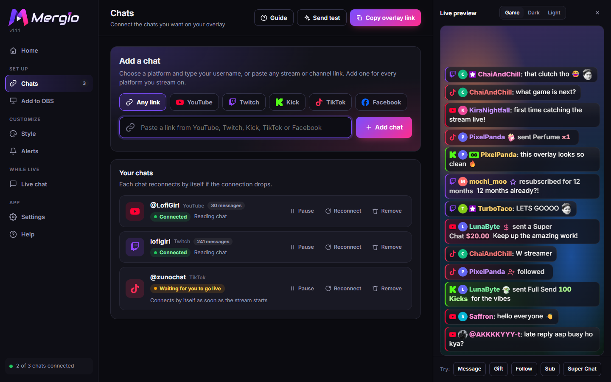
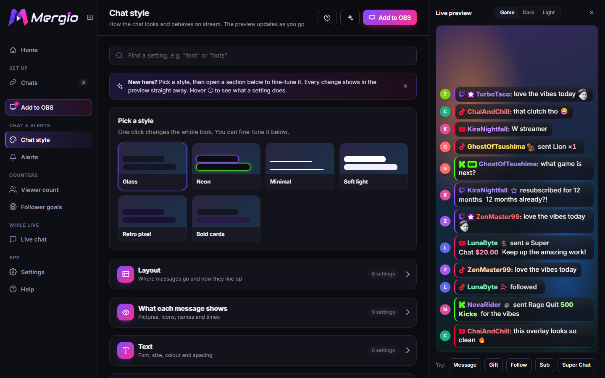
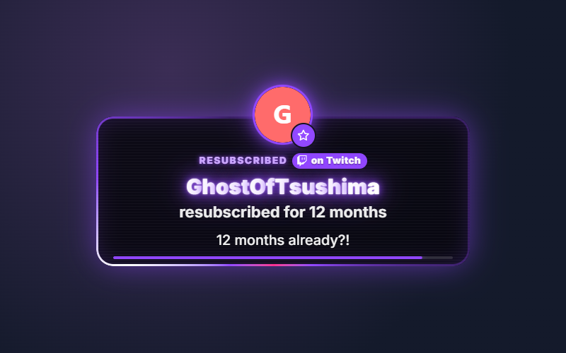
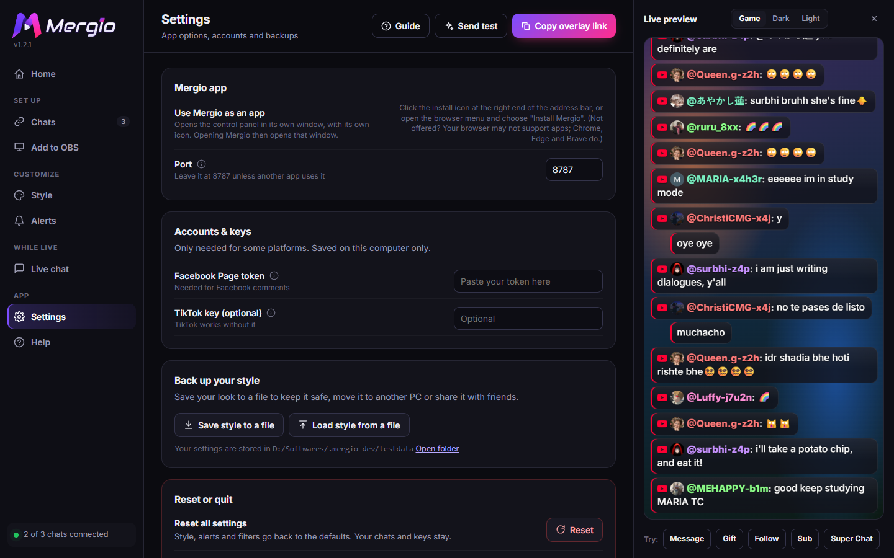

<div align="center">

<picture>
  <source media="(prefers-color-scheme: dark)" srcset="assets/brand/mergio-logo.svg">
  
</picture>

**Every live chat in one beautiful overlay.**
YouTube · Twitch · Kick · TikTok · Facebook, merged into a single OBS browser source.

[](LICENSE)


</div>

---

Multistreaming means your viewers chat in five different places. Mergio reads all of them at once and shows them as one good-looking chat on your stream, with real-time alerts for subs, gifts, Super Chats, raids, Bits, TikTok gifts and more.

**Paste a link. Press Enter. Done.** There are no developer accounts or API keys to set up, and no cloud service between you and your chat. It all runs on your own PC.

## Contents

- [Features](#features) · [Supported platforms](#supported-platforms)
- **[Complete guide](#complete-guide)**
  1. [Download](#step-1--download)
  2. [Install](#step-2--install) (Windows · macOS · Linux)
  3. [Open Mergio](#step-3--open-mergio)
  4. [Connect your chats](#step-4--connect-your-chats)
  5. [Make it yours](#step-5--make-it-yours)
  6. [Choose your alerts](#step-6--choose-your-alerts)
  7. [Add the overlay to OBS](#step-7--add-the-overlay-to-obs)
  8. [Optional: control Mergio from inside OBS](#step-8--optional-control-mergio-from-inside-obs)
  9. [Go live](#step-9--go-live)
- [Use Mergio as an app](#use-mergio-as-an-app)
- [Update or uninstall](#update-or-uninstall) · [Different looks per scene](#different-looks-per-scene)
- [Platform notes](#platform-notes) (YouTube, Twitch, Kick, TikTok, Facebook) · [Troubleshooting](#troubleshooting)
- [Privacy & security](#privacy--security) · [How it works](#how-it-works) · [Build it yourself](#build-it-yourself) · [For developers](#for-developers)
- [Contributing](#contributing) · [Credits](#credits) · [License](#license)

## Features

- 🔗 **Type a name or paste a link.** Pick a platform and type your username, or paste any stream or channel link. Mergio connects, and reconnects by itself if the connection drops.
- ⏳ **Auto-connect when you go live.** Add your channels once (YouTube, TikTok and Facebook too). Mergio notices when you go live and connects by itself; no live links to paste.
- 🖼️ **Real profile pictures for everyone in chat**, even in busy chats (Twitch pictures are looked up 100 at a time and cached).
- 🎁 **The real gift picture for every gift:** a Rose shows a rose, a Galaxy shows the galaxy, and TikTok combos count up live (×1 → ×10 → ×50). Kick's KICKs gifts show their own pictures too.
- 🔔 **Alerts where you want them:**
  - **In the chat** as a calm line with the gift picture, so they don't take over your chat
  - **On their own overlay**: a separate browser source you can put anywhere on your scene, showing one big animated alert at a time (**NEW SUBSCRIBER · on Twitch**, **GIFT · on TikTok**…)
  - **Or both**
- 🎉 **Every alert type:**
  - TikTok gifts, follows, subscriptions, joins, likes and shares
  - Twitch Bits with animated cheermotes, subs, gift subs, raids, Hype Chats, announcements, Power-ups and watch streaks
  - YouTube Super Chats in their real tier colors, Super Stickers, new members, milestones and gifted memberships
  - Kick follows, subs, gifted subs, KICKs gifts, hosts and reward redemptions
- ⏱️ **Disappearing messages (optional):** messages fade out after the time you choose, so only the newest stay on screen.
- 😀 **Emotes everywhere:** Twitch, 7TV, BetterTTV, FrankerFaceZ, YouTube custom emoji, Kick emotes, and cheermotes.
- 🎨 **Fully customizable:** 6 one-click styles (Glass, Neon, Minimal, Soft light, Retro pixel, Bold cards), any Google Font, colors, bubbles, opacity, roundness, animations, alignment, direction, emote size and more, with a settings search and a live preview that updates as you change things.
- ⚡ **Instant updates.** Style changes reach OBS immediately; you never re-copy the overlay link. The control panel tells you when OBS is showing your overlay.
- 🪟 **Install it as an app:** the control panel can open in its own window with its own icon instead of a browser tab.
- 🧹 **Moderation sync:** messages deleted or users banned on Twitch, YouTube or Kick vanish from the overlay too.
- 🛡️ **Filters:** hide `!commands`, bots, blocked words or a whole event type; set a minimum TikTok gift value; choose who may post images.
- 💬 **One feed for you:** a "Live chat" page to read every chat in one list. You can dock it inside OBS.
- 🪶 **Lightweight:** one small background app (about 50–80 MB of memory). The overlays only use GPU-friendly animations.
- 🔒 **Private:** everything runs on `localhost`. No telemetry, no accounts, no cloud.

<div align="center"></div>

## Supported platforms

| Platform | Chat | Events | Login / key needed? |
|---|---|---|---|
| **YouTube** | ✅ | Super Chats, Super Stickers, members, milestones, gifted memberships | No |
| **Twitch** | ✅ | Bits, subs, gift subs, raids, Hype Chats, announcements, Power-ups, watch streaks, joins | No |
| **Kick** | ✅ | Subs, gifted subs, Kicks gifts, hosts, reward redemptions, follows | No |
| **TikTok** | ✅ | Gifts (with images), joins, likes, follows, shares, subscriptions | No (optional free key raises limits) |
| **Facebook** | ✅ | Comments | **Yes**, a free Page access token ([how](#facebook)) |

\* Facebook does not allow reading live comments without a token. Twitch follows require a logged-in app, and Kick/YouTube don't publish viewer joins, so those few events aren't available.

## Complete guide

Everything you need, from download to your first stream. It takes about five minutes.

### Step 1 · Download

Go to the [**latest release**](https://github.com/ruchira-edirisinghe/mergio/releases/latest) and download the file for your computer:

| Your computer | File to download | What it is |
|---|---|---|
| **Windows 10 / 11** | `Mergio-Setup-windows-x64.exe` | Installer (recommended) |
| | `Mergio-windows-x64-portable.zip` | No install: unzip and run, e.g. from a USB stick |
| **Mac** (Apple Silicon: M1, M2, M3, M4…) | `Mergio-macos-arm64.dmg` | Drag-to-Applications disk image |
| **Ubuntu, Debian, Mint, Pop!_OS…** | `Mergio-linux-x64.deb` | Package with an app-menu entry |
| **Any other Linux** | `Mergio-linux-x64.tar.gz` | Unpack and run `./install.sh` (no root needed) |

### Step 2 · Install

<details open><summary><b>Windows</b></summary>

1. Double-click **`Mergio-Setup-windows-x64.exe`**.
2. If Windows shows *"Windows protected your PC"*, click **More info → Run anyway**. (Mergio is free and isn't code-signed, because signing certificates cost hundreds of dollars a year. The source is all here if you'd rather [build it yourself](#build-it-yourself).)
3. Choose **Install for me only** (no admin rights needed) or for all users.
4. Pick a folder, or keep the suggested one. Any drive works, for example `D:\Software\Mergio`.
5. Tick **Create a desktop shortcut** if you want one. Tick **Start Mergio quietly when I sign in** to always have the overlay ready.
6. Click **Install**, then **Finish**. Mergio opens right away.

You'll find **Mergio** in the Start menu (and on the desktop if you chose that). It also shows up in *Settings → Apps* like any other program.

**Portable version:** unzip `Mergio-windows-x64-portable.zip` anywhere and double-click **Mergio.exe**. Settings are saved in a `data` folder next to it, so you can carry the whole folder around.
</details>

<details><summary><b>macOS</b></summary>

1. Open **`Mergio-macos-arm64.dmg`**.
2. Drag **Mergio** onto the **Applications** folder.
3. Open **Mergio** from Applications or Launchpad.
4. The first time, macOS says it can't check the app for malware, because Mergio isn't notarized by Apple (that needs a paid developer account). Click **Done**, then open **System Settings → Privacy & Security**, scroll down to *"Mergio was blocked…"* and click **Open Anyway**. You only do this once.
   - Prefer the Terminal? Run `xattr -dr com.apple.quarantine /Applications/Mergio.app`, then open it normally.
</details>

<details><summary><b>Linux</b></summary>

**Debian, Ubuntu, Mint, Pop!_OS and similar:**

```bash
sudo apt install ./Mergio-linux-x64.deb
```

**Any distribution (installs only for your user, no root):**

```bash
tar -xzf Mergio-linux-x64.tar.gz
cd Mergio-linux-x64
./install.sh
```

Then open **Mergio** from your app menu, or run `mergio` in a terminal. Kick support uses `curl`, which most distributions already have (`sudo apt install curl` if yours doesn't).
</details>

### Step 3 · Open Mergio

Click the **Mergio** icon (Start menu, desktop, Launchpad or app menu). Mergio starts in the background and opens its **control panel** at `http://localhost:8787`. (Want it in its own window instead of a browser tab? See [Use Mergio as an app](#use-mergio-as-an-app).)

The first time, a short **tour** walks you through the next steps. You can open it again any time with the **Guide** button at the top of the control panel. The **Home** page always shows what's left to do.

<div align="center"></div>

> **Good to know:** closing the control panel doesn't stop the overlay; Mergio keeps running in the background. Clicking the Mergio icon again while it runs simply reopens the control panel. To fully close it, use **Settings → Reset or quit → Quit Mergio**.

### Step 4 · Connect your chats

1. Open **Chats**.
2. Pick your platform (YouTube, Twitch, Kick, TikTok or Facebook) and type your **username**. Or choose **Any link** and paste a stream or channel link.
3. Press **Enter**. Repeat for every platform you stream to; they all merge into one overlay.

Each chat shows its status: **Connected**, **Waiting for you to go live** (it connects by itself as soon as you go live) or a problem with a hint about what's wrong. You can pause, reconnect or remove each chat.

<div align="center"></div>

**Which links work?**

| Platform | Type or paste one of these |
|---|---|
| YouTube | your channel `@yourname` (finds your live stream automatically), `youtube.com/watch?v=VIDEO_ID`, `youtu.be/VIDEO_ID` or `youtube.com/live/VIDEO_ID` |
| Twitch | `yourname` or `twitch.tv/yourname` |
| Kick | `yourname` or `kick.com/yourname` |
| TikTok | `yourname`, `tiktok.com/@yourname` or `tiktok.com/@yourname/live` |
| Facebook | your Page `facebook.com/yourpage` (finds your live video automatically), or one live video `facebook.com/yourpage/videos/1234567890` (needs a free token, see [Facebook](#facebook)) |

**Tip:** add your channels once and leave them there. Every time you go live, Mergio connects on its own.

### Step 5 · Make it yours

Open **Style** and click one of the six looks (Glass, Neon, Minimal, Soft light, Retro pixel, Bold cards). **Quick settings** has the options most people change: text size and colour, profile pictures, platform icons, bubbles, left or right, newest at the top or bottom, and **Messages disappear after a while** (with the number of seconds). Everything else is in folding sections, and the search box finds any setting.

The **live preview** on the right updates instantly; use **Game / Dark / Light** above it to check how it looks over your stream.

<div align="center"></div>

| Section | What you can change |
|---|---|
| **Quick settings** | Text size and colour, profile pictures, platform icons, box behind each message (turn it off for plain text), alignment, disappearing messages and timer, newest at top or bottom |
| **What to show** | Badges, usernames, message text, pronouns, timestamps (12/24h) |
| **Text & colours** | Font, thickness, spacing, username colours, text shadow |
| **Message box & background** | Box colour, see-through, roundness, platform colour strip, overlay background |
| **Motion & layout** | Animation, most messages on screen, emote size, big emotes, one-line layout, grouping |
| **Alert look** | Alerts in the chat as calm lines with the gift picture or as big highlighted cards, follower alerts as alerts or small notes, how long "joined" notes stay |
| **Filters** | `!command` filter, picture links, ignored bots, blocked words |
| **Mentions & extras** | Highlight messages that mention you, extra names, UwU mode |

Press **Send test** at the top at any time to send sample messages and alerts.

### Step 6 · Choose your alerts

Open **Alerts**. At the top, choose **where alerts show**:

- **In the chat**: subs, gifts, Super Chats, follows and raids appear between messages as a calm line with the gift picture.
- **Their own overlay**: alerts leave the chat and show one at a time, big and animated, on a separate browser source you can put anywhere on your scene.
- **Both**: a small line in the chat plus the big alert.

<div align="center"></div>

If you pick an overlay, the page shows its link (`http://localhost:8787/alerts`) and the OBS steps. Add it like the chat overlay (step 7) as a second Browser source, for example **800 × 500**, and drag it wherever you want alerts to pop up. It's see-through until an alert comes in, and the box turns green when OBS shows it. You can set how long each alert stays, its size, where it sits in its box, the animation, and whether it shows the viewer's picture and message.

<div align="center">
 
</div>

Below that, **Which alerts and messages to show** lists everything each platform can show: TikTok gifts, follows, subscriptions, joins and likes; Twitch Bits, subs, gift subs and raids; YouTube Super Chats and memberships; Kick follows, subs, gifted subs and KICKs. Switch off anything you don't want on screen, and press **Try** to see any of them. For TikTok you can also set a minimum gift value.

### Step 7 · Add the overlay to OBS

1. In Mergio, open **Add to OBS** and click **Copy link** next to your overlay link (`http://localhost:8787/overlay`).
2. In OBS, click **+** under *Sources* and choose **Browser**. Name it *Mergio* and click **OK**.
3. Paste the link into **URL**. Set **Width** `500` and **Height** `800` (any size works; the chat fills the box).
4. Leave everything else as it is and click **OK**.
5. Move and resize the chat on your scene like any other source.

The **Add to OBS** page turns green (*Mergio is showing in OBS*) as soon as it works.

<div align="center"></div>

The link never changes, and style changes reach OBS instantly, so you never have to copy it again. It also works in Streamlabs Desktop, Meld, vMix, XSplit and TikTok LIVE Studio (add it as a browser or web source).

### Step 8 · Optional: control Mergio from inside OBS

Add the control panel as an OBS dock to read every chat and change settings without leaving OBS:

1. In OBS, open **Docks → Custom Browser Docks…** (older versions: *View → Docks*).
2. Name: `Mergio`. URL: `http://localhost:8787/dashboard`. Click **Apply**.
3. Open the **Live chat** page in the dock to read all your chats in one list.

<div align="center"></div>

### Step 9 · Go live

- Start Mergio before you go live, or turn on **Settings → Start Mergio with Windows** so it's always ready.
- Chats that say *Waiting for you to go live* connect by themselves when your stream starts.
- Every alert names the platform it came from, e.g. **NEW FOLLOWER · on TikTok** or **NEW SUBSCRIBER · on Kick**.

<div align="center"></div>

🎉 **That's it, you're all set!** Need help? [Open an issue](https://github.com/ruchira-edirisinghe/mergio/issues/new/choose) and describe what happened.

## Use Mergio as an app

The control panel can run in its own window, with its own icon on the taskbar, instead of a browser tab. This works in Chrome, Edge and Brave:

1. Open the control panel.
2. Click **Install app** at the top (or the install icon at the right end of the address bar), then **Install**.

From then on, opening Mergio on Windows opens that window. If you open the app while Mergio isn't running, it shows a **Start Mergio** button and switches to the control panel by itself once Mergio is up.

## Update or uninstall

**Update:** download the newest release and install it over the old one (Windows: run the new installer; macOS: drag the new app into Applications and replace the old one; Linux: install the new `.deb` or run the new `install.sh`). Your connections and style are kept.

**Uninstall:**

- **Windows:** *Settings → Apps → Installed apps → Mergio → Uninstall*. The portable version is just a folder: delete it.
- **macOS:** quit Mergio (*Settings → Reset or quit → Quit Mergio*), then drag **Mergio** from Applications to the Bin. Settings live in `~/Library/Application Support/Mergio`.
- **Linux:** `sudo apt remove mergio` for the `.deb`, or `./uninstall.sh` from the unpacked `tar.gz` folder.

**Back up your style first:** *Settings → Back up your style → Save style to a file* saves a small file you can import later or share with friends.

## Different looks per scene

Add any Style option to the overlay link to override it for that browser source only:

```
http://localhost:8787/overlay?fontSize=28&theme=neon&align=right&maxMessages=12
```

Useful options: `theme` (glass, neon, minimal, soft, retro), `fontSize`, `font`, `align` (left/right), `scrollDirection` (normal/reversed), `fadeMessages` (true/false) with `hideAfter` (seconds), `maxMessages`, `showAvatar`, `showPlatform`, `useChatBubbles`, `inlineChat`, `animation` (slide, pop, fade, none).

The alerts overlay works the same way: `http://localhost:8787/alerts?size=1.3&position=top&duration=8` (`size`, `position` top/center/bottom, `duration` in seconds, `animation` pop/slide/fade, `showAvatar`, `showMessage`).

## Platform notes

### YouTube
Uses the same public chat feed as YouTube's pop-out chat, so no API key and no quota. Paste a **video link** to read that stream, or your **channel link** (`youtube.com/@name`) to let Mergio find your current live stream automatically (it checks every 30 s while you're offline).

### Twitch
Connects to Twitch chat anonymously (read-only), like a logged-out viewer. Badges, emotes (Twitch, 7TV, BTTV, FFZ), Bits with animated cheermotes, subs, gifts, raids, announcements, Hype Chats, Power-ups and watch streaks all work. Turn on **Viewers joining chat** on the *Alerts* page if you want join notices (Twitch only sends these for channels with fewer than about 1,000 chatters).

### Kick
Reads Kick's public real-time chat as a guest. No login. Shows Kick emotes, badges, subs, gifted subs, Kicks gifts, hosts and reward redemptions.

### TikTok
Uses the open-source [TikTok-Live-Connector](https://github.com/zerodytrash/TikTok-Live-Connector). Shows comments, **who joined the LIVE**, **gifts with the real gift image and a live combo counter**, likes (grouped per viewer), follows, shares and subscriptions. You must be **LIVE** for it to connect. Until then the card says *Waiting* and checks again every 30 s.
TikTok connections are signed by the free [Euler Stream](https://www.eulerstream.com) service. If you ever see a rate-limit message, create a free key there and paste it into **Settings → Accounts & keys → Euler Stream key for TikTok**.

### Facebook
Facebook only shares live comments with apps that have a **Page access token**. It's free:

1. Open the [Graph API Explorer](https://developers.facebook.com/tools/explorer/) and log in with the account that manages your Page.
2. On the right, under **User or Page**, pick **Get Page Access Token** and choose your Page.
3. Add the permissions `pages_read_engagement` and `pages_show_list`, then click **Generate Access Token**.
4. Copy the token into **Mergio → Settings → Accounts & keys → Facebook Page token**.
5. On the Chats page, pick **Facebook** and type your Page name (or paste `facebook.com/yourpage`). Do this once: Mergio checks every 30 seconds whether your Page is live, connects to the live video's comments, and waits again when the stream ends. (You can still paste a single live video link instead.)

Tokens from the Explorer expire after about an hour. For one that lasts: open the [Access Token Debugger](https://developers.facebook.com/tools/debug/accesstoken/), paste the token, click **Extend Access Token**, then use that long-lived *user* token in the Explorer again to get a Page token. Page tokens made from a long-lived user token don't expire.

## Build it yourself

### Run from source

Requires [Node.js](https://nodejs.org) 20 or newer.

```bash
git clone https://github.com/ruchira-edirisinghe/mergio.git
cd mergio
npm install
npm start
```

`npm run dev` restarts the app when you edit files (and doesn't open the browser each time).

### Build the app and installers

```bash
npm install
npm run build        # -> dist/Mergio.exe (Windows) or dist/mergio (macOS/Linux)
npm run package      # -> installers for this OS in dist/release
```

`npm run build` bundles the code with esbuild and packs it, together with the web files, into a single executable using Node's built-in [Single Executable Applications](https://nodejs.org/api/single-executable-applications.html) feature. On Windows it also sets the icon and makes it a windowless app.

`npm run package` makes the installers for the system you run it on: the Windows installer needs [Inno Setup 6](https://jrsoftware.org/isinfo.php); the macOS disk image and Linux packages use the tools that come with those systems. Pushing a tag like `v1.2.0` builds everything for all three systems with GitHub Actions and publishes a release.

## How it works

```
 YouTube ─┐  (innertube live chat)
 Twitch ──┤  (anonymous IRC over WebSocket)                         ┌──> Overlay      (OBS browser source)
 Kick ────┼─> connectors ─> one message format ─> local server ─WS─┼──> Control panel (your browser / OBS dock)
 TikTok ──┤  (TikTok-Live-Connector)            (127.0.0.1:8787)    └──> Live chat feed
 Facebook ┘  (Graph API with your token)
```

- One small Node.js process runs everything: platform connectors, a tiny HTTP + WebSocket server and your settings.
- The overlay and control panel are plain HTML/CSS/JS pages served by that process; there's no framework and no build step for the UI.
- Settings are saved in `config.json`:
  - Windows (installer for one user, or portable): in a `data` folder next to `Mergio.exe`
  - Windows (installed for all users): `%APPDATA%\Mergio`
  - macOS: `~/Library/Application Support/Mergio`
  - Linux: `~/.config/Mergio` (`.deb`) or `~/.local/share/mergio/data` (`install.sh`)

**Resource use:** about 45 MB of memory with nothing connected and 70–80 MB with very busy chats (tested with a 20k-viewer Twitch chat plus a TikTok LIVE), and close to 0% CPU. Message lists are capped, avatar lookups are cached and rate-limited, and the overlay animates only `transform`/`opacity`.

## Privacy & security

- The server listens on **127.0.0.1 only**, so nothing on your network or the internet can reach it, and it rejects requests from other websites.
- No telemetry and no analytics; Mergio never phones home.
- Tokens and keys stay in your local `config.json` and are never sent to the overlay.
- Mergio only **reads** chat. It never posts, moderates or logs in as you.
- Third-party services used for display only: profile pictures for Twitch (Twitch's public API, `decapi.me` as a fallback) and Kick, the public TikTok gift list, Twitch pronouns (`pronouns.alejo.io`, only when enabled), 7TV/BTTV/FFZ emotes, TikTok signing (Euler Stream).

## Troubleshooting

<details><summary><b>A chat says "Waiting"</b></summary>
That platform isn't live yet, or the stream ended. Mergio keeps checking and connects by itself. Twitch and Kick connect even while offline.
</details>

<details><summary><b>The overlay is empty in OBS</b></summary>

- Check Mergio is running: <code>http://localhost:8787</code> should open the control panel.
- Make sure the Browser Source URL is exactly the one from **Add to OBS**.
- Press **Send test** in the control panel; if test messages show up, the overlay works and chat will appear when people type.
- Right-click the source → **Refresh**.
</details>

<details><summary><b>TikTok shows an error</b></summary>
Make sure you are LIVE and the username is correct. Rate-limit messages go away with a free Euler Stream key (Settings → Accounts & keys).
</details>

<details><summary><b>Facebook says the token is invalid or expired</b></summary>
Create a new Page token (see <a href="#facebook">Facebook</a>) and paste it in Settings → Accounts & keys. Mergio reconnects automatically.
</details>

<details><summary><b>Port 8787 is already used by another app</b></summary>
Change the port in <b>Settings → Mergio app</b>, restart Mergio and update the URL in OBS. You can also start it with the environment variable <code>MERGIO_PORT=9000</code>.
</details>

<details><summary><b>Nothing happens when I open Mergio</b></summary>

Mergio has no window; it opens the control panel in your browser. If no tab appears, open <code>http://localhost:8787</code> yourself. If that page doesn't load, another program may be using port 8787 (see below).
</details>

<details><summary><b>macOS says Mergio "is damaged" or "can't be opened"</b></summary>

That's Gatekeeper blocking an app that isn't notarized. Use <b>System Settings → Privacy &amp; Security → Open Anyway</b>, or run <code>xattr -dr com.apple.quarantine /Applications/Mergio.app</code> in Terminal.
</details>

<details><summary><b>Kick doesn't connect on Linux</b></summary>

Install <code>curl</code> (for example <code>sudo apt install curl</code>) and reconnect the Kick chat.
</details>

<details><summary><b>Where are the logs?</b></summary>

<code>mergio.log</code>, in the same folder as your settings (see <a href="#how-it-works">How it works</a>). The control panel shows the exact folder under <b>Settings → Back up your style</b> (with an <b>Open folder</b> button). The log is trimmed automatically at 1 MB.
</details>

## For developers

```
src/
  main.js          entry point: starts the server, opens the control panel, single-instance handling
  server.js        HTTP routes, REST API, WebSocket broadcast, avatar/pronoun helpers
  manager.js       list of sources, one connector per source, message buffer
  settings.js      defaults + persistence (every option lives here)
  detect.js        link -> { platform, target }
  connectors/      twitch.js, youtube.js, kick.js, tiktok.js, facebook.js (all extend base.js)
public/
  overlay/         the OBS browser source
  dashboard/       the control panel
  shared/          brand icons (generated from Simple Icons), glyphs, logo
scripts/           build.mjs (single executable), package.mjs (installers), gen-icons.mjs
packaging/         windows/ (Inno Setup), macos/ (.app + .dmg), linux/ (.deb, tar.gz + install.sh)
assets/brand/      logo, wordmark and icon (SVG + transparent PNG)
```

**Message format** (what connectors emit and the overlay receives):

```jsonc
{
  "id": "unique id (same id again = update, e.g. a TikTok gift combo)",
  "platform": "twitch | youtube | kick | tiktok | facebook",
  "type": "chat | superchat | supersticker | cheer | sub | giftsub | gift | raid | member | milestone | redemption | powerup | streak | announcement | join | like | follow | share",
  "time": 1795162628472,
  "user": { "id": "", "name": "", "login": "", "color": "#ff0000", "avatar": "https://…", "badges": [{ "id": "moderator", "title": "Moderator", "img": "https://…" }],
            "roles": { "broadcaster": false, "mod": true, "vip": false, "sub": false, "member": false, "verified": false } },
  "parts": [{ "type": "text", "text": "hello " }, { "type": "emote", "name": "Kappa", "url": "https://…" }],
  "event": { "kind": "gift", "title": "sent Rose", "amount": "×10", "image": "https://…", "color": "#fe2c55", "value": 10 },
  "flags": { "reply": { "name": "", "text": "" }, "firstMessage": false, "shared": false }
}
```

**Local API** (127.0.0.1 only): `GET /api/state`, `PUT /api/settings`, `POST /api/sources {input}`, `DELETE /api/sources/:id`, `POST /api/sources/:id/reconnect`, `POST /api/test {kind}`, and the WebSocket at `/ws` (`hello`, `msg`, `delete`, `settings`, `sources`, `clear`). You can build your own overlays on top of it.

**Adding a platform:** create `src/connectors/<name>.js` extending `Connector`, call `this.push({...})` with the format above, register it in `manager.js` and teach `detect.js` its links.

## Contributing

Bug reports, ideas and pull requests are welcome. Please open an issue first for bigger changes. Platforms change their internals often; if a connector breaks, an issue with the log lines from `mergio.log` helps a lot.

## Credits

- [TikTok-Live-Connector](https://github.com/zerodytrash/TikTok-Live-Connector) (MIT) and [Euler Stream](https://www.eulerstream.com) for TikTok
- [ws](https://github.com/websockets/ws) (MIT) for WebSockets
- [Simple Icons](https://simpleicons.org) (CC0) for platform logos
- [7TV](https://7tv.app), [BetterTTV](https://betterttv.com), [FrankerFaceZ](https://www.frankerfacez.com) for emotes; [pronouns.alejo.io](https://pronouns.alejo.io); [DecAPI](https://decapi.me)
- Settings inspired by the excellent multichat widgets of the streaming community

Mergio isn't affiliated with or endorsed by YouTube, Twitch, Kick, TikTok or Meta. All trademarks belong to their owners.

## License

[MIT](LICENSE) © Ruchira Edirisinghe. Free to use, modify and share, including commercially.
