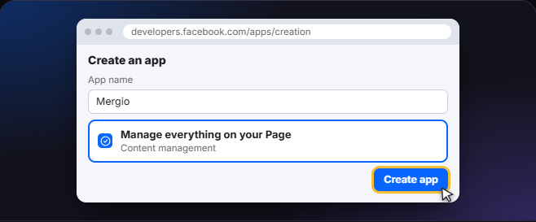
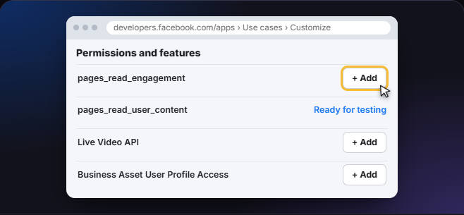
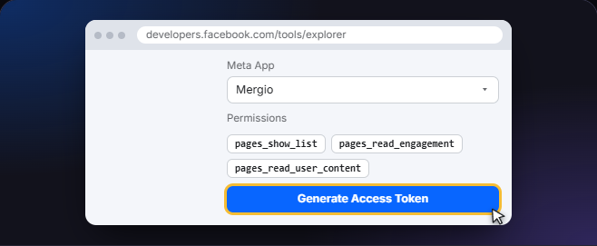
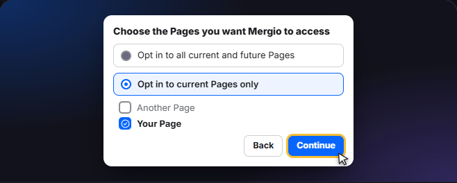
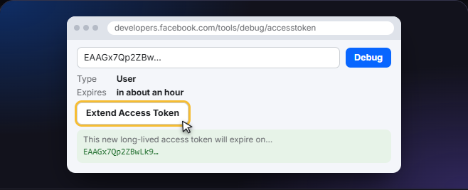
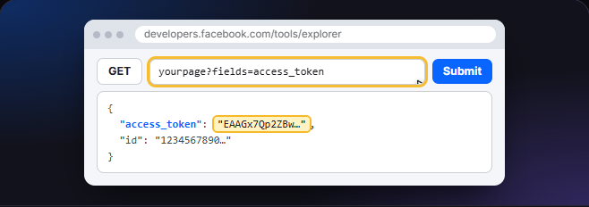

# Facebook Page token

Facebook only lets Mergio read your live comments with a free key called a **Page token**. You make it once. It takes about 5 minutes.

> **Easiest way:** in Mergio, open **Settings → Accounts & keys** and click **Show me how**. It takes you through these same steps with a picture of each Facebook screen, opens the right page for you and checks the token before it saves it.

Use a computer, and log in to Facebook with the account that manages your Page.

### 1. Create a free app

Facebook only gives tokens to apps, so you make your own. Only you can see it.
Open [Meta for Developers](https://developers.facebook.com/apps/creation/) (sign up if it asks, it's free). Name the app `Mergio` and click **Next**. Under **Content management**, tick **Manage everything on your Page**, then click **Next**. Choose **I don't want to connect a business portfolio yet**, then click **Next**, **Next** and **Create app**.

### 2. Switch on the permissions

In your app, click **Use cases**, then **Customize** next to *Manage everything on your Page*. Click **Add** next to `pages_read_engagement`, `pages_read_user_content`, **Live Video API** and **Business Asset User Profile Access**. Each one then says *Ready for testing*.

### 3. Make a token

Open the [Graph API Explorer](https://developers.facebook.com/tools/explorer/). Under **Meta App**, choose **Mergio**. Click **Add a Permission** and tick `pages_show_list`, `pages_read_engagement` and `pages_read_user_content`. Click **Generate Access Token**.

### 4. Allow your Page

In the window that pops up, click **Continue** (and again on *Switching accounts* if it shows). Choose **Opt in to current Pages only**, tick your Page and click **Continue**. Then click **Save** and **Got it**.

### 5. Make the token last

The token stops working after an hour, so swap it for one that lasts. Copy it, paste it into the [Access Token Debugger](https://developers.facebook.com/tools/debug/accesstoken/) and click **Debug**. Scroll down, click **Extend Access Token** and copy the new token.

### 6. Get your Page's token

Back in the Graph API Explorer, paste the new token into the **Access Token** box. In the bar at the top, type `yourpage?fields=access_token` (use your Page's name from its link, or its ID) and click **Submit**. Copy the long text after `"access_token"`, without the quotes. This Page token never expires.

### 7. Paste it into Mergio

Paste it under **Settings → Accounts & keys → Facebook Page token**, or in the last step of **Show me how**, which checks it first. Then, on the **Chats** page, pick **Facebook** and type your Page name (or paste `facebook.com/yourpage`).

You only do this once. Mergio checks every 30 seconds whether your Page is live, connects to the live video's comments and waits again when the stream ends. The same token also gives the Viewer count and Follower goals their Facebook numbers.

If Facebook asks you to log in again (about every 3 months), repeat steps 3 to 7.

[← Back to the README](../README.md)
